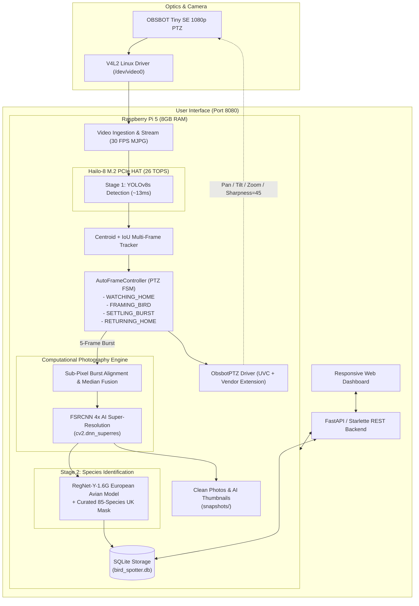

# 🐦 British Bird Spotter

[](https://www.raspberrypi.com/products/raspberry-pi-5/)
[-009688.svg)](https://hailo.ai/products/ai-accelerators/hailo-8-m2-ai-acceleration-module/)
[](https://www.obsbot.com/)
[](https://github.com/ultralytics/ultralytics)
[](https://github.com/opencv/opencv_contrib)
[](LICENSE)

**British Bird Spotter** is an autonomous garden wildlife photography, PTZ tracking, AI species classification, and ecological analytics system. Engineered specifically for British garden birds, it transforms a **Raspberry Pi 5**, **Hailo-8 M.2 AI accelerator (26 TOPS)**, and an **OBSBOT Tiny SE 2-axis PTZ camera** into a high-precision, 24/7 automated ornithology station.

---

## 🌟 Key Highlights

- **⚡ Sub-15ms Detection on Hailo-8 NPU**: Stage 1 YOLOv8s runs directly on Hailo-8 hardware at 30 FPS, providing smooth multi-frame centroid + IoU tracking without placing load on the Pi 5 CPU.
- **🎯 Intelligent PTZ Auto-Framing**: An autonomous finite state machine (`AutoFrameController`) detects bird presence, smoothly pans, tilts, and adjusts zoom so the subject occupies optimal frame area (3%–12%), pauses for gimbal settling, and fires high-speed burst captures.
- **✨ Anti-Pixelation Computational Photography**:
  - **Optical Zoom Enforcement**: Digital zoom clamped to $1.8\times$ max, eliminating digital pixel stretching on fixed-focal lenses.
  - **Hardware ISP Tuning**: UVC camera sharpness tuned to `45/100` to prevent harsh white ringing and artificial sensor halos.
  - **Noise-Gated Sharpness Metric**: Gaussian pre-filtered Laplacian variance ($\sigma=0.6$) reliably selects truly sharp optical focus rather than sensor noise spikes.
  - **Sub-Pixel Burst Stacking**: 5-frame burst fusion using phase-correlation sub-pixel translation and median temporal stacking to boost signal-to-noise ratio ($+3\text{ dB}$).
  - **AI Super-Resolution**: Post-capture $4\times$ deep learning upscaling via Fast Super-Resolution CNN (**FSRCNN $4\times$**) producing crisp $256\times256$ identification crops.
- **🦉 British Species Classification**: Stage 2 classification powered by **RegNet-Y-1.6G** (trained on Collins Bird Guide taxonomy, 707 European species) masked to a curated subset of ~85 British garden, woodland, and wetland species.
- **🛡️ Zone of Interest (ZOI) Filtering**: Configurable polygon masking ignores swaying foliage, bird feeder poles, or background movement outside the feeding zone.
- **🌐 Responsive Web Dashboard**:
  - Low-latency live MJPEG stream with toggleable Clean vs HUD overlays.
  - Manual PTZ D-pad and Zoom slider with automatic 60-second auto-framing pause and instant resume.
  - **Bird Dex (Life List)** tracking species sightings, peak confidence, and best photo.
  - Snapshot inspection modal with deep zoom, top-3 model predictions, species re-labeling, and false-positive deletion.
  - 24-hour hourly distributions and 14-day activity trends powered by SQLite.
- **☀️ Solar Twilight Scheduling**: Automatic civil twilight tracking puts camera and NPU into low-power sleep at dusk and resumes at dawn.

---

## 🏗️ System Architecture



---

## 📚 Complete Wiki Documentation

The repository includes a comprehensive, production-grade GitHub Wiki located in the [`wiki/`](wiki/) folder:

| Chapter | Document | Core Topics |
| :--- | :--- | :--- |
| **01** | **[Hardware Setup & BOM](wiki/Hardware-Setup-and-BOM.md)** | Bill of materials, OBSBOT Tiny SE quirks, Hailo-8 M.2 HAT PCIe gen 3 setup, active cooling, power budgets. |
| **02** | **[Architecture & Vision Pipeline](wiki/Architecture-and-Vision-Pipeline.md)** | Multi-stage pipeline, YOLOv8s NPU inference, tracking algorithm, PTZ state machine transitions, and photo capture policy. |
| **03** | **[AI Super-Resolution & Burst Stacking](wiki/AI-Super-Resolution-and-Burst-Stacking.md)** | Sub-pixel phase-correlation alignment, median stacking, FSRCNN $4\times$ upscaling, ISP sharpness tuning, and anti-pixelation. |
| **04** | **[Classifier & Species Identification](wiki/Classifier-and-Species-Identification.md)** | RegNet-Y-1.6G architecture, Collins Guide taxonomy, ~85 British garden species mask, and Hailo-8 `.hef` compilation. |
| **05** | **[Configuration Guide](wiki/Configuration-Guide.md)** | Complete line-by-line documentation of [`config/settings.toml`](config/settings.toml): PTZ bounds, zoom caps, exposure, and thresholds. |
| **06** | **[Web Dashboard & REST API](wiki/Web-Dashboard-and-REST-API.md)** | Web interface features, MJPEG streaming, Zone of Interest (ZOI) polygon editor, Bird Dex life-list, and OpenAPI reference. |
| **07** | **[Deployment & Operations](wiki/Deployment-and-Operations.md)** | Remote developer workflow with `scripts/pi5.sh`, systemd service management, log inspection, and automated database backups. |
| **08** | **[Troubleshooting & FAQ](wiki/Troubleshooting-and-FAQ.md)** | Step-by-step diagnostics for V4L2 video enumeration, Hailo PCIe link negotiation, UVC controls, and sharpness calibration. |

---

## ⚡ Quick Start

### Hardware Requirements

1. **Raspberry Pi 5** (4GB or 8GB recommended) with Raspberry Pi OS Bookworm 64-bit.
2. **Hailo-8 M.2 AI Acceleration Module** (26 TOPS) mounted via M.2 PCIe HAT.
3. **OBSBOT Tiny SE 1080p PTZ Camera** connected via USB 3.0.
4. **Active Cooler / Heatsink** for Raspberry Pi 5.

### Remote Development Workflow (`kbuntuPC` ➔ `Pi 5`)

This repository includes a production developer CLI helper [`scripts/pi5.sh`](scripts/pi5.sh) to orchestrate local development, testing, syncing, and service management on the Pi 5:

```bash
# 1. Run local test suite on PC (.venv)
./scripts/pi5.sh test-local

# 2. Run remote test suite on Raspberry Pi 5 hardware
./scripts/pi5.sh test

# 3. Full deployment: run tests, rsync code, restart systemd service, verify health
./scripts/pi5.sh deploy

# 4. Fast code sync (without service restart)
./scripts/pi5.sh sync

# 5. Check live hardware telemetry and status
./scripts/pi5.sh status
./scripts/pi5.sh logs
./scripts/pi5.sh check

# 6. Pull snapshots and SQLite database from Pi 5 to PC
./scripts/pi5.sh pull-data
```

### Direct Execution on Raspberry Pi 5

```bash
# 1. Verify camera, Hailo-8 NPU, and model files
PYTHONPATH=src python3 -m bird_spotter.main --check-hardware

# 2. Run the bird spotter service interactively
PYTHONPATH=src python3 -m bird_spotter.main

# 3. Access web dashboard in your browser
http://<raspberry-pi-ip>:8080/
```

---

## 🧪 Testing

The test suite covers vision processing, framing state machine, super-resolution enhancer, API endpoints, and species classifier:

```bash
# Run pytest locally
pytest tests/ -v
```

All 16 unit tests run cleanly without requiring hardware mocks or physical camera connection:
- `test_burst_stacking_identical_frames`
- `test_burst_stacking_subpixel_shift`
- `test_unsharp_mask`
- `test_super_resolution_enhancer_lifecycle`
- `test_noise_gated_sharpness_prefilter`
- `test_framing_burst_integration`
- `test_detector`, `test_ptz`, `test_api`, etc.

---

## 📊 Bird Dex & Species Coverage

The Stage 2 classifier covers over 700 European species with specific weighting and filtering for common British garden and countryside birds, including:

- **Garden Visitors**: European Robin (*Erithacus rubecula*), Blue Tit (*Cyanistes caeruleus*), Great Tit (*Parus major*), Eurasian Blackbird (*Turdus merula*), Common Chaffinch (*Fringilla coelebs*), European Greenfinch (*Chloris chloris*), European Goldfinch (*Carduelis carduelis*), House Sparrow (*Passer domesticus*), Dunnock (*Prunella modularis*), Long-tailed Tit (*Aegithalos caudatus*), Eurasian Wren (*Troglodytes troglodytes*).
- **Corvids & Pigeons**: Eurasian Magpie (*Pica pica*), Western Jackdaw (*Coloeus monedula*), Carrion Crow (*Corvus corone*), Common Wood Pigeon (*Columba palumbus*), Eurasian Collared Dove (*Streptopelia decaocto*).
- **Woodland & Countryside**: Great Spotted Woodpecker (*Dendrocopos major*), Eurasian Nuthatch (*Sitta europaea*), Eurasian Jay (*Garrulus glandarius*), European Starling (*Sturnus vulgaris*).

---

## 📜 License

This project is licensed under the MIT License — see the [LICENSE](LICENSE) file for details.
