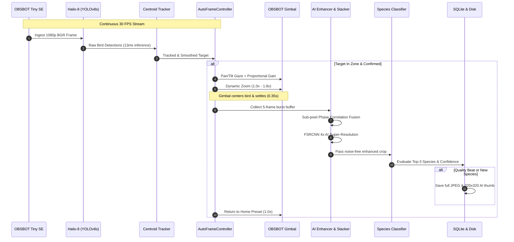
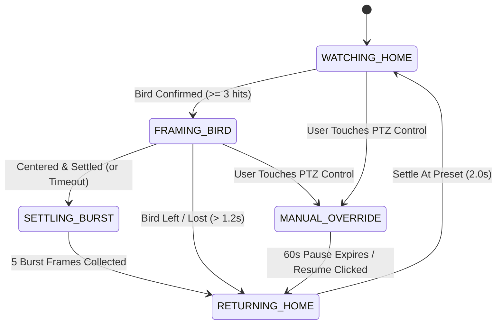

# Architecture & Vision Pipeline

Bird Spotter operates an autonomous real-time computer vision pipeline engineered to run 24/7 on edge hardware. It coordinates fast neural localization, multi-frame target tracking, mechanical PTZ framing, burst computational photography, and fine-grained species identification.

---

## 1. Pipeline Overview

---

## 2. Stage 1: Ultra-Fast Localization on Hailo-8 NPU

* **Model**: YOLOv8s compiled to Hailo Executable Format (`/usr/share/hailo-models/yolov8s_h8.hef`).
* **Input Resolution**: $640 \times 640 \times 3$ RGB.
* **Inference Latency**: **$\sim 12.8\text{ ms}$** per frame on the Hailo-8 M.2 module ($<2\text{W}$ power).
* **Target Classes**: Filters for `"bird"` (COCO class ID 14) with score threshold $\ge 0.35$ and IoU threshold $0.45$.
* **Coordinate Space**: Bounding boxes are normalized to $[0.0, 1.0]$ relative to the sensor frame width and height.

### Zone of Interest (ROI) Filtering

If a Zone of Interest (ROI) is defined on the dashboard (e.g. around the feeder tray and excluding windy tree branches), the detector filters out detections whose centroid falls outside the active normalized bounding box $(rx_1, ry_1, rx_2, ry_2)$.

---

## 3. Centroid + IoU Multi-Frame Target Tracking

Wild birds move erratically and rapidly flit in and out of frame. The `CentroidTracker` provides temporal stability:

1. **Multi-Frame Confirmation**: A bird must be detected for at least **3 consecutive frames** (`min_confirm_frames = 3`) before triggering PTZ tracking. Single-frame false positives (e.g. a falling leaf or camera glitch) are ignored.
2. **Coordinate Exponential Moving Average (EMA)**:
   $$\bar{x}_t = \alpha \cdot x_t + (1 - \alpha) \cdot \bar{x}_{t-1}, \quad \alpha = 0.45$$
   Centroid coordinates are smoothed to eliminate frame-to-frame bounding box jitter.
3. **Static False-Positive Suppression**: If an object remains motionless ($<0.02$ displacement) at low confidence ($<0.65$) for extended durations (e.g., a bird-shaped wooden knot on a fence), its coordinate anchor is added to a static suppression mask for 120 seconds.

---

## 4. The `AutoFrameController` State Machine

The PTZ controller implements a 5-state deterministic finite state machine (FSM):

### Detailed State Operations

1. **`WATCHING_HOME`**:
   The camera rests at the user-calibrated Home / Feeder Preset (`1.0x` zoom, $65^\circ$ FOV). YOLOv8 runs continuously. When a confirmed track is acquired, the controller locks onto the target track ID and transitions to `FRAMING_BIRD`.
2. **`FRAMING_BIRD`**:
   The controller centers the bird using proportional-gain gimbal tracking:
   $$\Delta \text{Pan} = \text{sign}_x \cdot (x_{\text{target}} - 0.5) \cdot K_{p,\text{pan}} \cdot \frac{1}{\max(1.0, Z)}$$
   $$\Delta \text{Tilt} = \text{sign}_y \cdot (y_{\text{target}} - 0.5) \cdot K_{p,\text{tilt}} \cdot \frac{1}{\max(1.0, Z)}$$
   *Note: Proportional gain is dynamically scaled down by $\frac{1}{Z}$ to prevent overshoot when zoomed in.*
   
   Once roughly centered, the zoom is gently adjusted so the bird occupies $3\% - 12\%$ of the frame (`target_min_area = 0.03`, `target_max_area = 0.12`). Zoom is capped at $\le 1.8\times$ to prevent sensor pixelation.
3. **`SETTLING_BURST`**:
   Once centered and gimbal movement has settled for $\ge 0.30\text{s}$ (`settle_delay_sec`), the controller rapidly records a **5-frame burst** into a buffer.
4. **`RETURNING_HOME`**:
   Once the burst is captured, the camera immediately resets zoom to $1.0\times$ and returns pan/tilt to the Home Preset. A 2.0-second settling window prevents false re-triggers while the gimbal moves.
5. **`MANUAL_OVERRIDE`**:
   If a user touches the manual D-Pad, zoom slider, or preset buttons in the web dashboard, auto-framing immediately pauses for **60 seconds**, displaying a live countdown banner.

---

## 5. Smart Photo Quality Policy

Every sighting is evaluated by a composite quality score:
$$Q = \text{confidence}_{\text{species}} \times \log_{10}(10.0 + \text{sharpness})$$

The database saves a clean full-resolution photo under three distinct conditions:
1. **New Species First Sighting**: The first time a species is seen, a photo is always taken.
2. **Quality Record Beaten**: If the new photo's $Q$-score exceeds the current best photo for that species in the Bird Dex life-list, the new photo becomes the new best reference.
3. **Cooldown Elapsed**: For frequent visitors (e.g. Blue Tit or Robin), new photos are saved if more than **300 seconds (5 minutes)** have passed since the last photo of that species.
