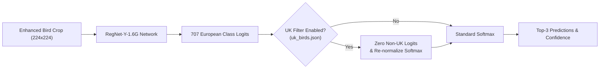

# Classifier & Species Identification

Once a bird is framed and an enhanced crop is extracted, Stage 2 identifies the specific bird species using fine-grained deep learning vision models.

---

## 1. Model Architecture & Origin

* **Base Model**: `birder-project/regnet_y_1_6g_eu-common` (RegNet-Y 1.6 GFLOPs architecture).
* **Taxonomy Reference**: Full European bird taxonomy from the *Collins Bird Guide* (707 species).
* **Exported ONNX Format**: [`models/uk_birds_regnet_y_1_6g.onnx`](file:///home/sean/Projects/bird-spotter/models/uk_birds_regnet_y_1_6g.onnx) ($\sim 43.7\text{ MB}$).
* **Input Preprocessing**:
  * Input dimensions: $224 \times 224 \times 3$ RGB.
  * Normalization: ImageNet mean $(\mu = [0.485, 0.456, 0.406])$ and standard deviation $(\sigma = [0.229, 0.224, 0.225])$.
* **Inference Backend**: Executed via OpenCV DNN engine (`active_backend = "opencv_dnn"`).

---

## 2. Curated British Garden & Countryside Mask

Pretrained European models often confuse British garden birds with rare continental or Mediterranean species (e.g., misidentifying a Coal Tit as an Azure Tit or a Robin as a Siberian Rubythroat).

To solve this, Bird Spotter incorporates a curated British species mask:
* **Configuration File**: [`config/uk_birds.json`](file:///home/sean/Projects/bird-spotter/config/uk_birds.json)
* **Coverage**: **85 common & notable British garden and countryside species**, including:
  * *Tits & Chickadees*: Blue Tit, Great Tit, Coal Tit, Marsh Tit, Willow Tit, Long-tailed Tit, Crested Tit.
  * *Finches & Sparrows*: Chaffinch, Greenfinch, Goldfinch, Bullfinch, Siskin, Linnet, Redpoll, House Sparrow, Tree Sparrow.
  * *Thrushes & Chats*: European Robin, Common Blackbird, Song Thrush, Mistle Thrush, Fieldfare, Redwing, Stonechat, Whinchat.
  * *Corvids*: Eurasian Magpie, Eurasian Jay, Western Jackdaw, Rook, Carrion Crow, Hooded Crow, Common Raven.
  * *Woodpeckers & Tree Climbers*: Great Spotted Woodpecker, Green Woodpecker, Lesser Spotted Woodpecker, Eurasian Nuthatch, Eurasian Treecreeper.
  * *Pigeons & Doves*: Common Woodpigeon, Eurasian Collared Dove, Stock Dove.
  * *Raptors & Owls*: Eurasian Sparrowhawk, Common Kestrel, Common Buzzard, Red Kite, Barn Owl, Tawny Owl, Little Owl.
  * *Warblers, Hirundines & Small Insectivores*: Eurasian Wren, Dunnock, Common Chiffchaff, Willow Warbler, Blackcap, Barn Swallow, Common House Martin, Common Swift.

### Mask Filtering Mechanics



When `uk_filter_enabled = true`:
1. Logits for species outside the UK mask are masked to $-\infty$.
2. The remaining probabilities are re-normalized via Softmax:
   $$P(c_i) = \frac{e^{z_i \cdot \text{mask}_i}}{\sum_{j \in \text{UK}} e^{z_j}}$$
3. This guarantees that identifications always map to genuine British wildlife.

---

## 3. Confidence Thresholds & "Unidentified Bird" Handling

* **`min_confidence = 0.25`** ($25\%$):
  If the top predicted species confidence is below $25\%$, the sighting is automatically recorded as **`"Unidentified Bird"`**.
* **Top-3 Predictions**: Every sighting records the top-3 candidate species and their associated probabilities in `top_predictions_json` (e.g. `[{"species": "Blue Tit", "confidence": 0.82}, ...]`).
* **Manual Override**: If an ambiguous or juvenile bird is misclassified, users can re-label or batch re-label sightings directly from the web dashboard.

---

## 4. Compiling to Hailo-8 HEF (Optional x86_64 Workflow)

While the ONNX model runs at $\sim 45\text{ ms}$ on the Pi 5 CPU, it can also be compiled to run on the Hailo-8 NPU ($\sim 5\text{ ms}$) using the provided compilation script:

```bash
# Run on an x86_64 host with Hailo Dataflow Compiler installed
python3 scripts/compile_hailo_classifier.py --compile-hef --host 192.168.100.101 --user sean
```

This compiles `models/uk_birds_regnet_y_1_6g_h8.hef`. When present, Bird Spotter automatically switches the active classifier backend from `opencv_dnn` to `hailo_hef`.
