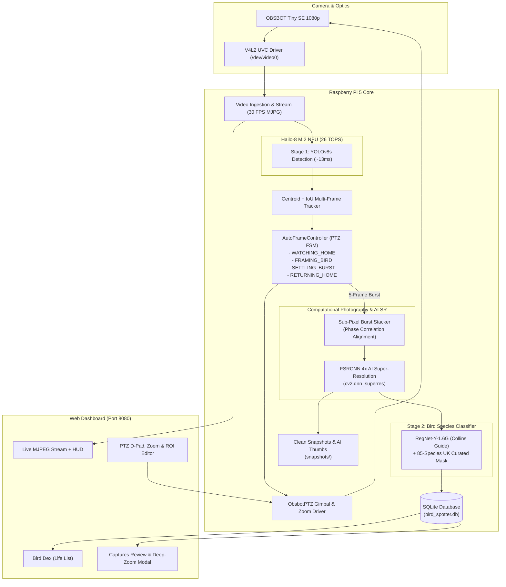

# 🐦 British Bird Spotter — Wiki

Welcome to the **British Bird Spotter** documentation wiki!

**British Bird Spotter** is an autonomous garden wildlife surveillance, PTZ auto-framing photography, species identification, and analytics system powered by a **Raspberry Pi 5**, **Hailo-8 M.2 AI Acceleration Module (26 TOPS)**, and an **OBSBOT Tiny SE PTZ Camera**.

---

## 📚 Wiki Contents

| Section | Description |
| :--- | :--- |
| **[Hardware Setup & BOM](Hardware-Setup-and-BOM.md)** | Bill of materials, OBSBOT Tiny SE UVC/SDK quirks, Hailo-8 M.2 HAT setup, Raspberry Pi 5 cooling & power. |
| **[Architecture & Vision Pipeline](Architecture-and-Vision-Pipeline.md)** | End-to-end architecture: 30 FPS YOLOv8s localization on NPU, tracking, PTZ state machine, and capture pipeline. |
| **[AI Super-Resolution & Burst Stacking](AI-Super-Resolution-and-Burst-Stacking.md)** | Detailed guide on sub-pixel burst fusion stacking, FSRCNN/ESPCN deep learning super-resolution, and anti-pixelation tuning. |
| **[Classifier & Species Identification](Classifier-and-Species-Identification.md)** | Collins Bird Guide 707-species RegNet-Y-1.6G classifier, curated ~85 British garden species mask, and Hailo-8 compilation. |
| **[Configuration Guide](Configuration-Guide.md)** | Complete reference for `config/settings.toml`: PTZ limits, area ratios, camera ISP sharpness, zoom caps, and solar scheduling. |
| **[Web Dashboard & REST API](Web-Dashboard-and-REST-API.md)** | Web dashboard features, live MJPEG streaming, Zone of Interest (ROI) editor, Bird Dex life-list, deep-zoom modal, and REST endpoints. |
| **[Deployment & Operations](Deployment-and-Operations.md)** | Systemd service setup, remote development workflow with `scripts/pi5.sh`, live telemetry monitoring, and DB backups. |
| **[Troubleshooting & FAQ](Troubleshooting-and-FAQ.md)** | Common issues, V4L2 enumeration, Hailo-8 PCIe verification, UVC controls, and image sharpness tuning. |

---

## 🚀 System Architecture High-Level Overview

---

## 🌟 Key Highlights

1. **Two-Stage Intelligent Pipeline**: High-speed 30 FPS localization on the Hailo-8 NPU coupled with a fine-grained 707-species European bird classifier filtered by an 85-species British garden bird mask.
2. **Mechanical Framing Without Degradation**: Smooth proportional-gain gimbal tracking with digital zoom capped at $\le 1.8\times$ and calibrated camera ISP sharpness ($45/100$) to prevent pixelation.
3. **Sub-Pixel Computational Photography**: 5-frame burst phase correlation stacking eliminates random sensor grain and compression artifacts, boosting SNR by up to $\sim 2.2\times$.
4. **Deep-Learning Super-Resolution**: Built-in OpenCV `dnn_superres` with **FSRCNN $4\times$** reconstructs crisp feather edges and eye rings in just $19\text{ ms}$ on the Pi 5.
5. **Solar-Aware Automation**: Calculates solar dawn/dusk twilight times dynamically, automatically waking the camera at dawn and placing it into deep standby after dusk.
